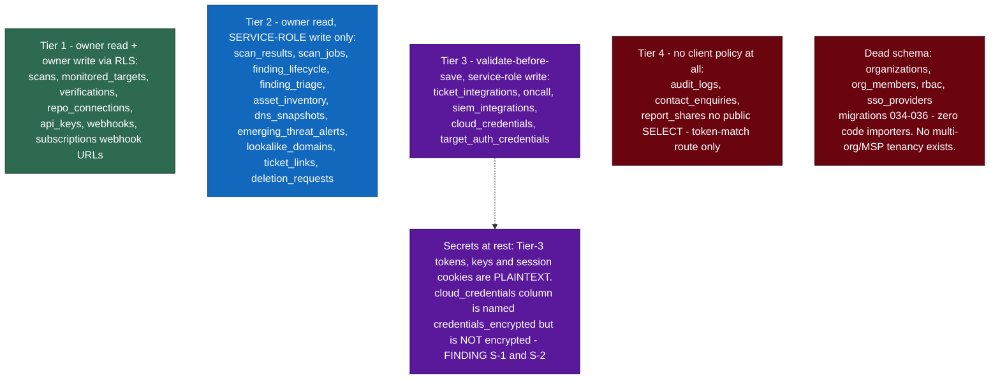

# Data model & tenant isolation

The **visual** companion to the authoritative per-table prose in
[`../CLAUDE.md`](../CLAUDE.md) ("Database schema") and the gating detail in
[`FUNCTIONALITY-MATRIX.md`](FUNCTIONALITY-MATRIX.md). This file owns the diagrams
only — it does not restate what those files say; where a table's behaviour is in
question, they are the arbiter. Canonical diagram sources:
[`diagrams/er-core.mmd`](diagrams/er-core.mmd),
[`diagrams/er-rls-tiers.mmd`](diagrams/er-rls-tiers.mmd).

Migrations `sql/migrations/001`–`062` (the sequence skips 023). Every user-data table has RLS enabled;
the only bypass is server-side code using the service-role key. Isolation is
tested on real Postgres in `tests/db/rls.db.test.ts`.

## Entity-relationship (core)

```mermaid
erDiagram
    users ||--o| subscriptions : has
    users ||--o{ scans : owns
    users ||--o{ monitored_targets : owns
    users ||--o{ verifications : owns
    users ||--o{ repo_connections : owns
    users ||--o{ api_keys : owns
    users ||--o{ clients : owns
    clients ||--o{ monitored_targets : groups
    clients ||--o{ verifications : groups
    users ||--o{ webhooks : owns
    users ||--o{ teams : owns
    users ||--o{ cloud_credentials : owns
    users ||--o{ ticket_integrations : owns
    users ||--o{ finding_lifecycle : owns
    users ||--o{ finding_triage : owns
    users ||--o{ asset_inventory : owns
    users ||--o{ deletion_requests : requests
    scans ||--|| scan_results : produces
    scans ||--o{ scan_jobs : queued_as
    scans ||--o{ report_shares : shared_via
    monitored_targets ||--o| target_auth_credentials : "authed cred"
    monitored_targets ||--o{ scan_jobs : scheduled_as
    teams ||--o{ team_members : contains
    ticket_integrations ||--o{ ticket_links : "finding->issue ledger"
    finding_lifecycle ||--o| sla_policies : "measured against"
    users {
        uuid id PK "= auth.users.id"
        bool is_admin "self-grant blocked by migration 017"
    }
    subscriptions {
        text plan "basic|pro|agency|tier_a"
        text status "active|past_due|cancelled"
        text source "stripe|admin override (052)"
    }
    scans {
        text status
        int score "severity penalties weighted by CVSS/KEV/EPSS, floors at 0"
    }
    scan_jobs {
        uuid scan_id FK "null => scheduled"
        text scan_profile "safe|full|offensive"
        uuid client_id FK "nullable = Unassigned; ON DELETE SET NULL (064)"
    }
    clients {
        uuid id PK
        uuid owner FK
        text name "unique per owner, case-insensitive (064)"
        text notes
        text brand_name "per-client override of the account brand"
        text brand_logo_url "https only"
    }
    api_keys {
        text key_hash "sha-256 only; plaintext shown once at creation"
        text_array allowed_cidrs "IP allowlist (042)"
        text_array scopes "scans:read|scans:write|dependency:check (063)"
    }
    cloud_credentials {
        text provider "aws|azure|gcp"
        jsonb credentials_encrypted "PLAINTEXT - FINDING S-1"
    }
    blog_posts {
        text status "draft|published|scheduled"
        text meta_description "collected, NOT persisted - CMS bug"
    }
```

## RLS / credential-sensitivity tiers

> **Review findings referenced:** S-1/S-2 (plaintext credentials-at-rest) and the
> dead org/RBAC/SSO schema are detailed in
> [`PRODUCT-REVIEW-2026-10.md`](PRODUCT-REVIEW-2026-10.md) (Phase 6 / Phase 1).
