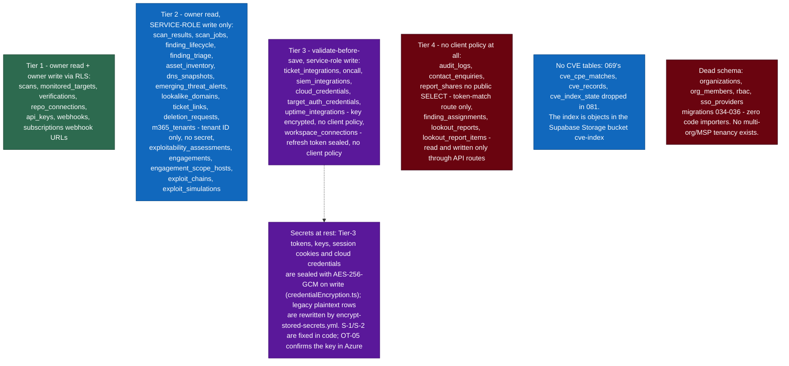

# Data model & tenant isolation

The **visual** companion to the authoritative per-table prose in
[`ARCHITECTURE-NOTES.md`](ARCHITECTURE-NOTES.md) ("Database schema", moved
there from `CLAUDE.md` on 2026-10-20) and the gating detail in
[`FUNCTIONALITY-MATRIX.md`](FUNCTIONALITY-MATRIX.md). This file owns the diagrams
only — it does not restate what those files say; where a table's behaviour is in
question, they are the arbiter. Canonical diagram sources:
[`diagrams/er-core.mmd`](diagrams/er-core.mmd),
[`diagrams/er-rls-tiers.mmd`](diagrams/er-rls-tiers.mmd).

82 migrations (`sql/migrations/001`–`082`, checked 2026-11-20). Every user-data
table has RLS enabled; the only bypass is server-side code using the
service-role key. Isolation is tested on real Postgres in
`tests/db/rls.db.test.ts`.

## Changes since 2026-11-14 (migrations 075–082)

| Migration | PR | Change |
|---|---|---|
| `075_lookout_reports.sql` | #242 | New `lookout_reports` (customer, period, `status` draft/published/acknowledged, summary, publish and acknowledgement times) and `lookout_report_items` (host, check_id, severity, title, `included`, `priority`, `analyst_note`, `business_impact`, `fix_owner` customer/it_supplier/hosting_provider/unknown; unique on report + host + check_id). RLS on, no policies: service role only |
| `076_workspace_connections.sql` | #243 | New `workspace_connections`: one Google Workspace refresh token per owner (sealed), scopes, connected and last-checked times. Service role only; built dark until OT-58 |
| `077_repo_connection_targets.sql` | #248 | `repo_connections.target_host`: the site a repository belongs to. Backfilled for owners with exactly one monitored site; repository findings on sites with no linked repository, and stale `sast-rules/` findings, deleted from `finding_lifecycle` |
| `078_finding_assignments.sql` | #249 | New `finding_assignments`: one assignee per (owner, target_host, check_id), with `assigned_by` and `assigned_at`. Cascades from `auth.users`. Service role only |
| `079_weekly_fix_email.sql` | #255 | `subscriptions.notify_weekly_fix` (boolean, default true) and `weekly_fix_sent_at`, `weekly_fix_host`, `weekly_fix_check_id`, `weekly_fix_title` (last week's suggestion) |
| `080_repo_link_reminder.sql` | #267 | `repo_connections.link_reminder_sent_at`: when the one "link this repository" email was sent |
| `081_drop_cve_index_tables.sql` | #268 | Drops `cve_cpe_matches`, `cve_records`, `cve_index_state` and the `replace_cve_batch` function (all from 069). The CPE → CVE index is now gzipped objects in the private Supabase Storage bucket `cve-index` (Azure Blob optional), so it no longer counts toward the database's 500 MB |
| `082_offensive_authorization_expiry.sql` | #280 | Sets `expires_at = now() + 30 days` on every unrevoked `offensive_scan_authorizations` row that had none. New authorizations must carry an expiry at most 30 days out (enforced in the API) |

## Entity-relationship (core)

```mermaid
erDiagram
    users ||--o| subscriptions : has
    users ||--o{ scans : owns
    users ||--o{ monitored_targets : owns
    users ||--o{ verifications : owns
    users ||--o{ repo_connections : owns
    users ||--o{ api_keys : owns
    users ||--o{ webhooks : owns
    users ||--o{ teams : owns
    users ||--o{ cloud_credentials : owns
    users ||--o| m365_tenants : connects
    users ||--o{ ticket_integrations : owns
    users ||--o{ finding_lifecycle : owns
    users ||--o{ finding_triage : owns
    users ||--o{ exploitability_assessments : owns
    scans ||--o{ exploitability_assessments : assessed
    engagements ||--o{ engagement_scope_hosts : scopes
    engagements ||--o{ exploit_chains : maps
    engagements ||--o{ exploit_simulations : plans
    users ||--o{ asset_inventory : owns
    users ||--o{ deletion_requests : requests
    users ||--o{ finding_assignments : "owns / is assigned"
    users ||--o{ lookout_reports : "receives (customer)"
    lookout_reports ||--o{ lookout_report_items : contains
    users ||--o| workspace_connections : connects
    users ||--o{ offensive_scan_authorizations : "authorises per host (Tier A)"
    scans ||--|| scan_results : produces
    scans ||--o{ scan_jobs : queued_as
    scans ||--o{ report_shares : shared_via
    monitored_targets ||--o| target_auth_credentials : "authed cred"
    monitored_targets ||--o{ scan_jobs : scheduled_as
    teams ||--o{ team_members : contains
    ticket_integrations ||--o{ ticket_links : "finding->issue ledger"
    finding_lifecycle ||--o| sla_policies : "measured against"
    users {
        uuid id PK "= auth.users.id"
        bool is_admin "self-grant blocked by migration 017"
    }
    subscriptions {
        text plan "basic|pro|agency|tier_a"
        text status "active|past_due|cancelled"
        text source "stripe|admin override (052)"
        bool notify_weekly_fix "default true (079)"
        timestamptz weekly_fix_sent_at "plus weekly_fix_host, _check_id, _title"
    }
    repo_connections {
        text github_repo
        text target_host "site it belongs to (077); null = never scanned"
        timestamptz link_reminder_sent_at "080"
    }
    finding_assignments {
        text target_host
        text check_id "unique with owner + target_host"
        uuid assignee FK
    }
    lookout_reports {
        text status "draft|published|acknowledged"
        date period_start
        date period_end
    }
    lookout_report_items {
        int priority
        bool included
        text fix_owner "customer|it_supplier|hosting_provider|unknown"
    }
    offensive_scan_authorizations {
        timestamptz expires_at "at most 30 days out (082)"
        timestamptz revoked_at
    }
    scans {
        text status
        int score "severity penalties weighted by CVSS/KEV/EPSS, floors at 0"
    }
    scan_jobs {
        uuid scan_id FK "null => scheduled"
        text scan_profile "safe|full|offensive"
    }
    cloud_credentials {
        text provider "aws|azure|gcp"
        jsonb credentials_encrypted "AES-256-GCM, CREDENTIALS_ENC_KEY"
    }
    blog_posts {
        text status "draft|published|scheduled"
        text meta_description "collected, NOT persisted - CMS bug"
    }
```

## RLS / credential-sensitivity tiers

> **`monitored_targets.criticality` / `.environment` (067).** `low | normal |
> high` (default `normal`) and `production | staging | development | test` (or
> null). They weight the estate "fix this first" rank (`estatePriority.ts`).
> Owner-writable under 026's UPDATE policy like `scan_profile`; team members
> can read but not change them.

> **Review findings referenced:** S-1/S-2 (plaintext credentials-at-rest, since
> fixed in code: see "Secrets at rest" in `ARCHITECTURE-NOTES.md`) and the
> dead org/RBAC/SSO schema are detailed in
> [`PRODUCT-REVIEW-2026-10.md`](PRODUCT-REVIEW-2026-10.md) (Phase 6 / Phase 1).
