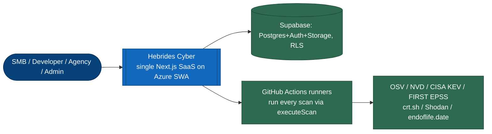

# Hebrides Cyber — one-page overview

*For funders, prospective buyers and new stakeholders. Every claim here is
verifiable against the code; where a capability is partial or unwired, it says
so. Authoritative detail: [`FUNCTIONALITY-MATRIX.md`](FUNCTIONALITY-MATRIX.md).*

## What it is
An automated web-security scanning SaaS for UK SMEs and agencies — a continuous,
affordable successor to the retired NCSC Web Check / Mail Check. Point it at a
domain you own; it runs dozens of evidence-based checks and returns a scored
report with copy-pasteable fixes, framework compliance mapping, and (optionally)
a pull request that applies the fix.

## Who it's for
Small businesses with a compliance trigger (Cyber Essentials, procurement),
developers who want a CI security gate, and agencies monitoring multiple sites.
Built and run from the Isle of Lewis.

## System at a glance

Full diagram set: [`diagrams/`](diagrams/) · architecture narrative:
[`architecture.md`](architecture.md).

## What genuinely ships (code-verified)
- **~40 passive checks** (TLS/cert, security headers/CSP/cookies, DNS + email auth
  SPF/DKIM/DMARC/MTA-STS/TLS-RPT/CAA/DNSSEC, exposure, cloud-bucket misconfig,
  tech fingerprint, ports, CMS deep scans, JS-lib CVEs, SRI, EOL software, domain
  registration, dangling-DNS takeover, CT subdomains, crawler, GraphQL).
- **~27 extended active tools** on scheduled scans (nmap, nuclei + interactsh OOB
  SSRF, sqlmap, commix, ZAP, Subfinder, httpx, testssl, Gitleaks, dependency +
  CycloneDX SBOM, Trivy, Opengrep SAST with an in-house rule pack, zizmor).
- **Threat intel**: CISA KEV + FIRST EPSS + NVD + OSV enrichment on every CVE.
- **Remediation ladder**: static text → AI-tailored fix → ticket (Jira/Linear/
  ServiceNow/GitHub, with dedupe + auto-close) → real pull request.
- **Monitoring**: scheduled scans, New/Fixed diffing, score/compliance trends,
  SLA tracking, triage, emerging-threat / attack-surface / lookalike-domain alerts.
- **Reporting**: executive PDF, CSV/JSON, per-framework compliance export across
  7 frameworks (incl. Cyber Essentials, PCI DSS, ISO 27001, NIS2, DORA).
- **Integrations**: public REST API + keys, webhooks, GitHub Action + CI templates,
  Slack/Teams, SIEM forwarding, on-call (PagerDuty/Opsgenie).

## Honest limitations (as of 2026-10)
- **Paid signup is not live** — Stripe price IDs unset in production (E-07).
- **No true multi-org / MSP tenancy** (org/RBAC/SSO schema is unwired dead code).
- **Google OAuth is a stub** (the code exists; the provider isn't enabled in Supabase and
  there is no button on `/login`). Sign-up (`/signup`) and password reset are live.
- **Offensive "AI pen-test" tier is not usable** (Strix/Cairn never run).
- **No DMARC aggregate-report processing**, no continuous standalone EASM, no
  dark-web monitoring beyond HIBP domain lookups.
- **Solo-operator**: no 24/7 cover, no SOC 2/ISO/CREST, support is self-serve.

See the full assessment in [`PRODUCT-REVIEW-2026-10.md`](PRODUCT-REVIEW-2026-10.md).
