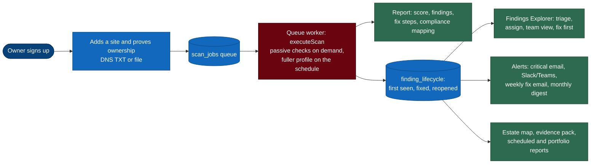
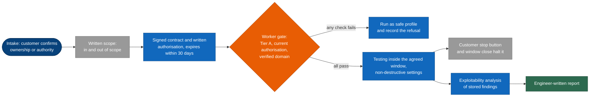

# Products

What each Hebrides Cyber product is, who it is for, what it costs, what is
live and what is waiting on the owner. Checked against `master` on
2026-11-20. Everything here describes built code or a documented manual
service (rule OT-14); planned work is labelled as planned.

| Product | One line | Status |
|---|---|---|
| [Scanner](#scanner) | Self-serve security monitoring for a small business's websites | Live and priced; no real purchase tested yet |
| [Lookout](#lookout) | Managed exposure review: daily checks plus an engineer-written report | Page live, sold by hand; checkout waiting on owner items |
| [Exploit](#exploit) | Authorised, contracted penetration testing by engagement | **Not launched. Do not market.** |
| [Phishing awareness](#planned-phishing-awareness) | Simulated phishing and staff training | Design only |

Detail lives elsewhere and is linked rather than repeated: per-check detail in
[`SCANNER-INVENTORY.md`](SCANNER-INVENTORY.md), gating in
[`FUNCTIONALITY-MATRIX.md`](FUNCTIONALITY-MATRIX.md), routes in
[`API.md`](API.md), owner items in [`OWNER-TODO.md`](OWNER-TODO.md).

---

## Scanner

### Executive summary

- **What it is.** Automated, continuous security monitoring of the websites a
  business owns. It checks each site on a schedule, explains each finding in
  plain English with fix steps, ranks what to fix first, and tracks fixes over
  time.
- **Who it is for.** UK small businesses and the agencies or IT suppliers who
  look after their sites, plus developers who want a check in their CI.
- **Price.** Basic £20 a month (1 site, weekly scans), Pro £35 (3 sites,
  daily, code and dependency checks, Slack/Teams, evidence pack), Agency £75
  (15 sites, teams, white-label reports, logged-in scanning, SLA tracking,
  portfolio report). One free scan without a plan.
- **Status.** Live at www.hebridescyber.co.uk. Stripe checkout is configured;
  no real purchase has been made to prove it end to end. Email works (OT-02
  done 2026-11-20).
- **Waiting on the owner.** Security and operations items before marketing:
  OT-01 (database password), OT-05/OT-28 (encryption key), OT-06 (rate
  limiting), OT-07 (branch protection), OT-08 (Sentry), OT-49 (tool updates),
  OT-50 (tool licences), OT-14 (copy check), OT-57 (sign-in email), OT-62
  (replace the exposed Resend key). Optional: OT-17 (breach and NVD keys),
  OT-63 (Google sign-in).

### How it works

1. The owner adds a site and proves they control the domain. Scans never run
   against an unverified domain.
2. A "Run scan" click queues a passive scan, picked up within about a minute;
   results usually arrive in 3 to 5 minutes. Scheduled scans (Basic weekly,
   Pro and Agency daily) use the site's scan profile, which can include the
   active checks.
3. Every scan runs the base passive suite: TLS, headers, DNS and email
   authentication, exposed files, known-vulnerable libraries, CMS checks, a
   crawl, breach data and more. Scheduled scans add the extended suite where
   the profile allows it. With a GitHub repository linked to the site, the
   code checks run too.
4. Each finding is compared with the last scan of the same site: new, still
   open, fixed or reopened. A failed lookup never counts as fixed.
5. The owner works the list in the dashboard and gets alerts.

### Features

- **Reports.** Score, findings with plain-English fix steps (including
  platform-specific steps), compliance mapping, executive PDF, remediation
  pack, share links, CSV/JSON export, SBOM.
- **Prioritisation.** "Fix this first" ranks every open finding across all
  sites with a reason; known-exploited and likely-exploited flags; an
  exploitability band with "Why?" on Pro and up. Findings from a tool the site's
  current profile no longer runs drop out of the ranking (#259).
- **Working the list.** Findings Explorer across all sites; bulk triage
  (accept, false positive, snooze); **assign to a person** with an email to the
  assignee (#249); **team members read the owner's findings** read-only,
  defaulting to "assigned to me" (#250); SLA deadlines (Agency); tickets in
  Jira, Linear, ServiceNow or GitHub with auto-close.
- **Seeing the estate.** Asset inventory; **estate map** of every host with web
  status, certificate expiry, exposed services and open issues (#265);
  "What changed" over 7, 30 or 90 days; new-subdomain and DNS-change alerts;
  lookalike-domain alerts; emerging-threat alerts when a newly exploited CVE
  matches something a site runs.
- **Evidence.** **Security evidence pack** PDF for insurers, supplier
  questionnaires and Cyber Essentials, every answer labelled Evidenced, Gap
  found, Self-declared or Your records (Pro and up, #264); Cyber Essentials
  self-assessment and readiness.
- **Email.** Critical-finding alerts; **weekly "one thing to fix" email**
  naming the single most urgent finding, on by default with a switch to turn it
  off (#255); monthly digest; scheduled reports.
- **Code and CI.** Connect a GitHub repository and **link it to one of your
  sites** (#248); secrets, dependencies, Dockerfile, infrastructure-as-code and
  code scanning then run on that site's scans only. A dashboard banner and a
  one-off email prompt owners to link older connections (#267). Fix PRs for
  dependency findings; a CI script and templates; pull-request dependency
  checks.
- **Accounts.** Magic link or password sign-in with TOTP two-factor; "Continue
  with Google" built but hidden until OT-63 (#273); API keys with IP
  allowlists; webhooks; teams and roles (Agency); white-label (Agency);
  Microsoft 365 posture checks (Pro and up, tenant consent).

### Data it uses

- **Tables:** `monitored_targets`, `verifications`, `scans`, `scan_results`,
  `scan_jobs`, `finding_lifecycle`, `finding_triage`, `finding_assignments`,
  `asset_inventory`, `repo_connections` (with `target_host`), `subscriptions`
  (plan, alert settings, `notify_weekly_fix`), `teams`, `team_members`,
  `ticket_integrations`, `ticket_links`, `m365_tenants`. Schema:
  [`DATA-MODEL.md`](DATA-MODEL.md).
- **External sources:** free public feeds (OSV.dev, NVD, CISA KEV, FIRST EPSS,
  certificate logs, endoflife.date, the Wayback Machine) and optional keyed
  ones (Have I Been Pwned, Google Safe Browsing, WPScan). The local CVE index
  sits in the Supabase Storage bucket `cve-index`.
- **Storage:** Azure Blob for report PDFs and host screenshots.

### Plan gating

All gates go through `src/lib/planAccess.ts`; only an active subscription
grants a tier, and admins are exempt. Basic: 1 site, weekly. Pro: 3 sites,
daily, repository connection, Slack/Teams, uptime, Microsoft 365, evidence
pack, exploitability detail. Agency: 15 sites, teams, white-label, logged-in
scanning, SLA tracking, portfolio report. Not plan-gated by design: triage,
assignment, estate map, weekly email (any active subscription), API keys,
share links, tickets (OT-10 is the open decision). Full table:
[`FUNCTIONALITY-MATRIX.md`](FUNCTIONALITY-MATRIX.md) §6.

### Owner items outstanding

OT-01, OT-05, OT-06, OT-07, OT-08, OT-10, OT-11, OT-12, OT-14, OT-17, OT-27,
OT-28, OT-29, OT-49, OT-50, OT-57, OT-62, OT-63, plus one real purchase and
refund to prove checkout. Status of each: [`OWNER-TODO.md`](OWNER-TODO.md).

---

## Lookout

### Executive summary

- **What it is.** A managed exposure review. Daily automated checks of what
  the internet can see of a business, and an engineer-written report on what
  to fix first, who should fix it and why it matters. It sends no injection or
  attack traffic and is not a penetration test.
- **Who it is for.** Small businesses that want a person to read the results
  and tell them what matters, often because an insurer or customer asks.
- **Price.** Essentials £149 a month (£399 a quarter or £1,490 a year):
  quarterly report and review call. Assured £299 a month (£799 a quarter or
  £2,990 a year): monthly report, two calls a quarter, help with Cyber
  Essentials and insurance questionnaires. Extras quoted.
- **Status.** The `/lookout` page is live (also forwarded from
  `lookout.hebridescyber.co.uk`) with "Book a call", and the service is sold by
  hand. The report tooling is built and usable now. There is no online
  checkout and no Lookout plan in code yet: checkout is draft PR #199.
- **Waiting on the owner.** OT-33 (name and prices), OT-34 (Stripe prices),
  OT-35 (terms wording), OT-42 (tier limits), OT-43 (traffic disclosure and
  cover), OT-45 (pilot-first launch and five prospects), OT-56 (custom domain;
  forwarding done). OT-44 (review the restricted check lists) is also open.
  OT-17 switches on breached accounts; OT-58 switches on Google Workspace
  checks; OT-64 (our own Cyber Essentials) comes before Lookout advertising.

### How it works

```mermaid
flowchart LR
    classDef user fill:#08427b,stroke:#052e56,color:#fff
    classDef app fill:#1168bd,stroke:#0b4884,color:#fff
    classDef job fill:#6a040f,stroke:#370617,color:#fff
    classDef out fill:#2d6a4f,stroke:#1b4332,color:#fff
    C([Customer: scoping call,<br/>verified domains]):::user --> S[Sites set to the<br/>non-intrusive exposure profile]:::app
    S --> D[Daily scans: web, TLS, DNS and email,<br/>exposed services, screenshots,<br/>Microsoft 365 posture]:::job
    D --> K[(Findings, ranking, drift,<br/>lookalikes, breach data)]:::app
    K --> A[Analyst: draft report in admin panel,<br/>customer found by email]:::user
    A --> E[Edit items: include, priority,<br/>business impact, who fixes it]:::app
    E --> P[Publish]:::app
    P --> R[Customer report page<br/>+ dated PDF with estate gallery]:::out
    R --> Ack[Customer acknowledges<br/>report is then frozen]:::out
    R --> Call[Review call,<br/>fix confirmed at next report]:::user
```

1. Scoping call, then the customer verifies each domain. Their sites are set
   to the `exposure` profile, which runs only non-intrusive checks.
2. Daily scans collect findings, host screenshots and posture data.
3. At the end of the period the analyst creates a draft in the admin panel's
   Lookout tab, finding the customer by sign-up email (#256). The draft is
   prefilled from the estate ranking, the period's drift, new lookalike domains
   and breach data.
4. The analyst chooses which items to include, sets priorities, writes the
   business impact and a note, names who fixes each one (the customer, their
   IT supplier, their hosting provider) and publishes.
5. The customer reads the report at `/dashboard/lookout`, downloads the dated
   PDF and acknowledges it. Acknowledging is not acceptance of risk. A
   published report can be corrected until it is acknowledged.

### Features

- **The report (#242).** Period, summary, prioritised items with severity,
  site, who fixes it, why it matters and the engineer's note; acknowledgement.
- **Dated PDF and estate gallery (#252).** `lookout-report-<period end>.pdf`,
  with up to 12 host screenshots from the latest scan in the period, so
  forgotten sites show at a glance. Admins can preview drafts.
- **Lookalike domains (#253).** Registered lookalikes of the customer's domain
  that our weekly sweep spotted in the period, how each differs and when it
  was found, plus how many were known before. New drafts get a summary line.
- **Breached email accounts (#258).** Per site, known breaches that included
  addresses on the domain: name, date, address count and the kinds of data
  leaked. Counts and breach names only; no individual address is stored or
  shown. Left out entirely until `HIBP_API_KEY` is set (OT-17), and shows "not
  enabled yet" for a domain not verified with the breach service.
- **Analyst workflow (#256).** Start a report from the customer's email
  instead of copying a user id.
- **Shared with Scanner and used by Lookout:** the exposure profile, fix-first
  ranking, "What changed" drift, the estate map (#265), the evidence pack
  (#264; Pro-gated in Scanner, and an "insurance evidence pack" is listed as a
  quoted Lookout extra), Microsoft 365 posture checks, and Google Workspace
  posture checks (built dark until OT-58).

### Data it uses

`lookout_reports` and `lookout_report_items` (migration 075, service role
only), plus the customer's `finding_lifecycle`, `finding_triage`, the estate
ranking, `lookalike_domains`, each site's latest scan's breach result and host
screenshots in Azure Blob. The PDF is rendered on request and not stored.

### Plan gating

None in code yet. Reports are created by an admin for a named customer, and a
customer sees only their own published reports. Forcing Lookout customers onto
the `exposure` profile by plan arrives with checkout (#199).

### Owner items outstanding

OT-33, OT-34, OT-35, OT-42, OT-43, OT-45, OT-56 (partly done), plus OT-44,
OT-17, OT-58 and OT-64.

---

## Exploit

> **Not launched. It must not be marketed, advertised or linked** until the
> owner has completed OT-13 (solicitor-reviewed engagement contract and
> professional indemnity insurance) and made the OT-51 go decision. The
> `/exploit` page is noindex, unlinked from the main site, absent from the
> sitemap and carries a "not yet available" banner.

### Executive summary

- **What it is.** Authorised penetration testing by engagement: a fixed,
  written scope; a signed contract and written authorisation; non-destructive
  settings; an agreed testing window with an immediate stop; and an
  engineer-written report of which exposures a real attacker could use.
- **Who it is for.** Businesses that need a contracted test, for example for
  a customer, an insurer or a compliance requirement, and that already know
  their exposure from Scanner or Lookout.
- **Price.** Quoted per engagement. Pricing is set after a manual pilot
  (OT-54). Engagements are booked by hand, never by self-serve checkout
  (OT-52).
- **Status.** Not launched. Parts of the platform are built (below); the
  engagement record, scope enforcement and stop controls are in draft PRs.
- **Waiting on the owner.** OT-13 (contract and insurance), OT-51 (go or
  no-go), OT-52 (booking by hand), OT-53 (whether the autonomous agents are in
  the first version), OT-54 (pricing), OT-55 (insurance covers contracted
  testing).

### How it would work

Grey boxes are in draft PRs, not on `master`: the engagement record (#260),
worker enforcement of the signed scope, window and expiry (#261), the
customer status page with a stop button (#263) and halting a run already
under way (#266).

### What is built on `master`

- **Authorisation records.** `POST /api/account/offensive-authorization`
  (Tier A, session only) records a per-site authorisation with an
  acknowledgement and scope text. Since #280 it **must expire within 30 days**,
  and migration 082 gave every open-ended authorisation a 30-day expiry.
- **The worker gate.** An offensive job runs only when the owner is on Tier A,
  holds a current authorisation for the target, and the domain is verified;
  otherwise it runs as `safe` and the refusal is audited. The Tier A plan is
  not sold or shown on the pricing page.
- **Exploitability analysis engine.** Pure analysis of findings a scan already
  holds; it sends nothing (enforced by lint rules and tests). Its summary band
  already appears in Scanner for Pro and up. Engagement and chain tables
  (migrations 070 and 071) exist with nothing writing them yet.
- **The product page.** `/exploit`, noindex, with the "not yet available"
  banner.

### Data it uses

`offensive_scan_authorizations` (with `expires_at`), `monitored_targets`,
`verifications`, `exploitability_assessments`, and the schema-only
`engagements`, `engagement_scope_hosts`, `exploit_chains` and
`exploit_simulations`.

### Plan gating

Tier A for authorisations and the offensive profile, enforced on the server
and again in the worker. Customer engagements will not be self-serve.

### Owner items outstanding

OT-13, OT-51, OT-52, OT-53, OT-54, OT-55. Design and limits:
[`EXPLOIT-PRODUCT-PLAN.md`](EXPLOIT-PRODUCT-PLAN.md),
[`EXPLOITABILITY-ENGINE.md`](EXPLOITABILITY-ENGINE.md).

---

## Planned: phishing awareness

**Design only; nothing is built** (#251). Simulated phishing campaigns for a
customer's staff, with a short course for anyone who clicks. The design in
[`PHISHING-AWARENESS-DESIGN.md`](PHISHING-AWARENESS-DESIGN.md) is supportive
rather than punitive (the reporting rate is the headline measure), never
captures credentials, needs a written authorisation per campaign, avoids
real-brand impersonation by default and sends from dedicated domains, never
hebridescyber.co.uk. Proposed phases: a managed pilot inside Lookout, then
self-serve for Pro and up, then a report button for Outlook and Gmail. Owner
items: OT-59 (solicitor and insurer sign-off), OT-60 (sending domains and an
email provider whose terms allow simulations), OT-61 (course licence and
pricing).
