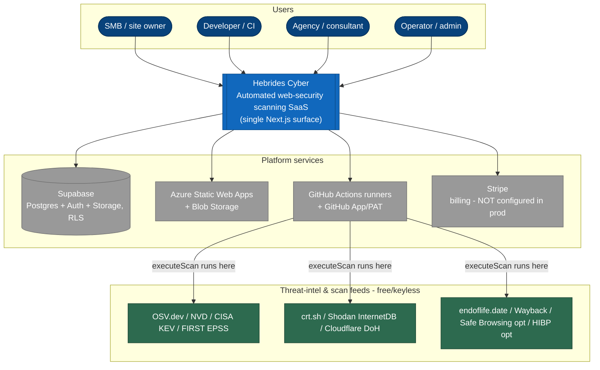
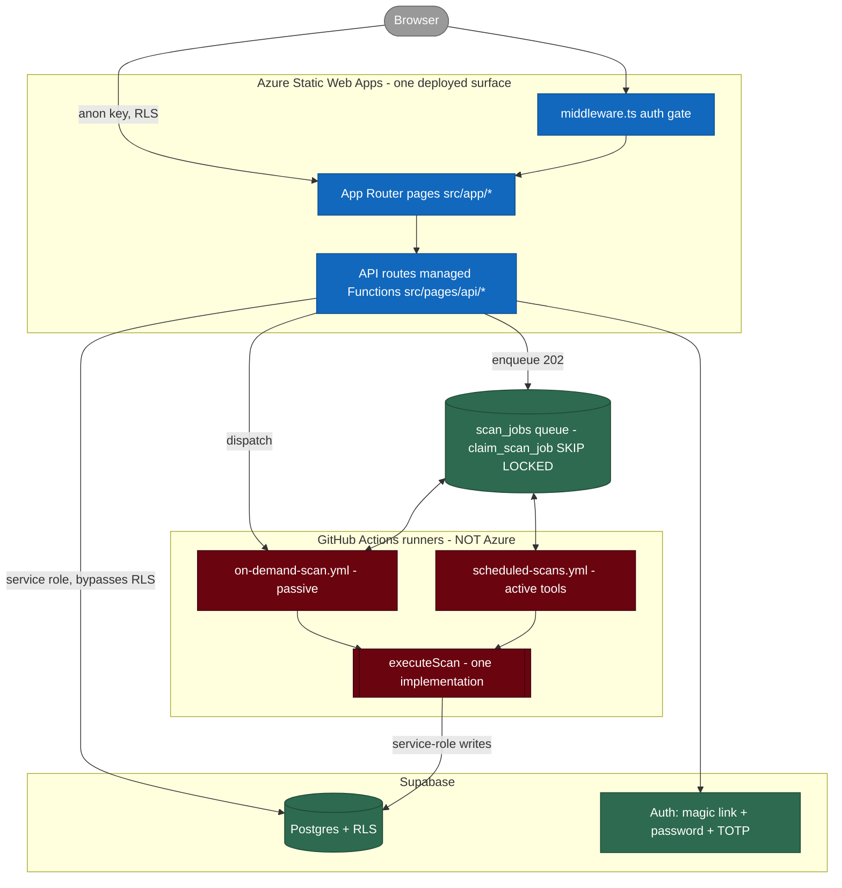
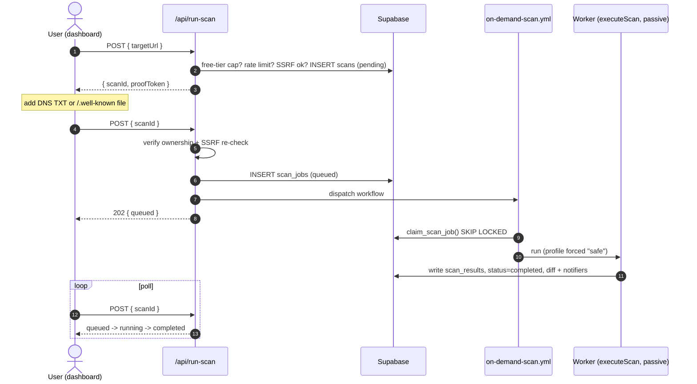
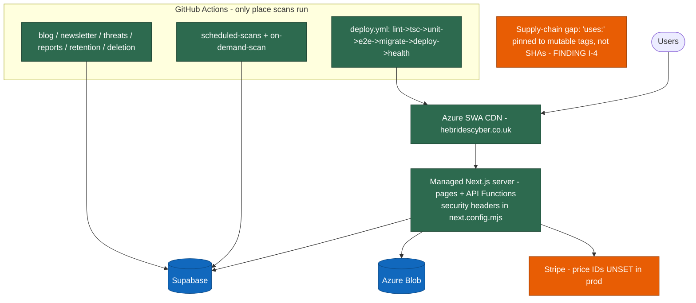

# Architecture

Current, as of the live production system — not an aspirational or MVP
description. For the day-to-day technical reference (what to read before
editing which file), see this same folder's `CLAUDE.md` (not the git
root — this repo has two roots; see `docs/README.md`); this doc is the
higher-level picture.

## System diagrams

Diagrams render inline on GitHub. The canonical sources are the Mermaid files in
[`diagrams/`](diagrams/) (`npm run docs:diagrams` exports SVG/PNG to
`diagrams/exports/` for slide decks). Full index: [`diagrams/README.md`](diagrams/README.md).
Every box follows the folder's standing rule — it marks `STUB`/`GAP`/`FINDING`
where that is the truth, per `FUNCTIONALITY-MATRIX.md`.

### C4 — system context

### C4 — containers

For the scan-pipeline component view, see
[`diagrams/c4-component-scanner.mmd`](diagrams/c4-component-scanner.mmd).

## One deployed surface

The entire app — marketing site, client dashboard, and every API route —
is one Next.js app deployed to Azure Static Web Apps. Oryx auto-deploys
`src/pages/api/*` as managed Functions behind the CDN. There is no separate
standalone Azure Functions app; one existed early on, was never actually
deployable, and was fully consolidated into this single surface.

## Data flow: an on-demand scan

1. A user signs up/in via Supabase Auth (magic link or Google OAuth).
2. From the dashboard, they submit a target URL. The client calls
   `/api/run-scan` **twice**:
   - First with `{ targetUrl }` — creates a `scans` row (`pending`) and
     returns a proof token.
   - Then with `{ scanId }` — verifies real domain ownership (DNS TXT
     record or file upload; a dev-only token-echo shortcut exists but is
     off by default everywhere), and if verified, **enqueues** a
     `scan_jobs` row and returns `202 { status: "queued" }`.
3. The scan does **not** run inline in that request. A real production
   scan once exceeded Azure Static Web Apps' Free-tier Functions execution
   ceiling and returned a proxy error instead of JSON — every scan-running
   path was moved off synchronous HTTP execution as a result (this applies
   to the daily blog/weekly newsletter generation too, which hit the exact
   same failure independently and was fixed the same way).
4. `src/lib/onDemandScanTrigger.ts` immediately dispatches
   `.github/workflows/on-demand-scan.yml` via the GitHub API, so the job is
   usually picked up within about a minute; if that dispatch fails, the job
   still gets picked up by the next scheduled cron as a fallback.
5. The dashboard polls step 2 again to see `queued` → `running` →
   `completed`/`failed`.

Scheduled scans share the same queue but run the full/active tool suite — see
[`diagrams/seq-scheduled-scan.mmd`](diagrams/seq-scheduled-scan.mmd) and the
profile/offensive-gate flow in
[`diagrams/flow-scan-profile-gating.mmd`](diagrams/flow-scan-profile-gating.mmd).

## Data flow: the queue worker (shared by on-demand and scheduled scans)

`src/scripts/run-queued-scan-jobs.ts` claims jobs via a Postgres
`claim_scan_job()` RPC (`SELECT ... FOR UPDATE SKIP LOCKED`) and runs each
one with `src/lib/scanExecution.ts`'s `executeScan()` — the single
implementation every scan-running path shares, so behaviour never drifts
between an on-demand scan and a scheduled one.

- `executeScan()` always runs the **base passive suite**
  (`src/lib/scanners/index.ts`'s `runAllChecks()`) — TLS, headers, DNS,
  exposure, cloud misconfig, fingerprinting, ports, recon, WordPress/
  Joomla/Drupal deep scans, JS library CVEs, SRI, Safe Browsing, Wayback,
  HaveIBeenPwned, WPScan plugin CVE matching.
- Pass `runExtendedTools: true` to also run the **extended active-tool
  suite** — nmap, nuclei (template-scoped to detected technology),
  Subfinder, testssl.sh, plus (with a connected GitHub repo) Gitleaks
  secret scanning, dependency-manifest scanning (npm/pip/Composer), and
  Dockerfile base-image checks, plus (with a saved credential) the
  authenticated header/cookie recheck.
- Only jobs from `scheduled-scans.yml` get that flag — on-demand jobs stay
  passive-only, distinguished by whether the job's `scan_id` arrived
  pre-set (an on-demand job reuses an existing `scans` row created at step
  2 above; a scheduled job creates its own).

Two GitHub Actions workflows work this same queue:

- `scheduled-scans.yml` — nightly cron, installs the real tool binaries +
  a ZAP daemon fresh each run (no persistent infrastructure), then a
  fixed-size matrix of worker shards drains the queue.
- `on-demand-scan.yml` — a lighter sibling with no tool installs, dispatched
  immediately per on-demand scan rather than waiting for the next cron.

Neither runs on Azure — Azure Static Web Apps' Consumption-plan Functions
have no shell access and can't install binaries at all, which is the whole
reason this queue design exists rather than running tools inline.

## After a scan completes

- Results + score write to `scan_results` via the service-role key.
- A compliance-mapping pass (`src/lib/scanners/compliance.ts`) tags each
  finding against Cyber Essentials/OWASP Top 10/CIS Controls v8 where it
  genuinely applies.
- The New/Fixed diff is computed against the previous scan of the same
  target (by hostname, not exact URL string).
- Outbound webhooks fire (HMAC-signed), a Slack and/or Teams alert posts if
  configured and something changed, and a critical-finding email sends on
  any active plan (not gated to a paid tier the way Slack/Teams are).
- The dashboard reads the result back through the user's own RLS-scoped
  Supabase session — the service-role key never reaches the browser.

## Content generation (daily blog + weekly newsletter)

Two independently-scheduled posts, not one replacing the other, sharing
real-event sourcing (`src/lib/newsletter.ts`: CISA's KEV catalog, NVD
high-severity CVEs, established security-news RSS feeds). Both run as
plain scripts (`src/scripts/generate-daily-blog.ts` /
`generate-weekly-newsletter.ts`) executed directly by their GitHub Actions
workflows against Supabase — not API routes. They used to be, and hit the
same Azure Functions execution-ceiling failure the scan pipeline did; fixed
the same way, by removing the HTTP hop entirely.

## Security model

- **RLS everywhere.** Every table holding user data has row-level security
  enabled. The only code path that bypasses it is server-side code using
  the service-role key — never the browser.
- **Credential sensitivity tiers.** A webhook URL (Slack/Teams) is
  client-writable via RLS. A third-party API token (GitHub, Jira, Linear)
  or a session cookie for authenticated scanning is not — those tables ship
  with no client-writable RLS policy at all, and are only ever written by a
  dedicated API route that validates the credential against the real
  service first (where a generic "am I authenticated" signal exists to
  validate against — GitHub, Jira, and Linear all have one; an arbitrary
  customer site being authenticated-scanned does not, so that one credential
  type is saved without a live validation call, documented as a deliberate
  limitation rather than a false assurance).
- **Real ownership verification.** No scan runs against a domain without a
  DNS TXT record or file-upload proof of control — required by default on
  every deployment.
- **SSRF checks** run at scan-creation time and again at execution time
  (a job can sit queued for a while) before any target is actually
  fetched.
- **Secrets never in git.** `.env.example` documents required variable
  names with no real values. See `docs/security.md` for where each secret
  actually belongs (Azure app settings vs. GitHub Actions secrets — note
  that GitHub hard-rejects any Actions secret name starting with `GITHUB_`,
  which is why `GITHUB_PAT`/`GITHUB_APP_ID`/`GITHUB_APP_PRIVATE_KEY` are
  stored there under different names and remapped in each workflow's own
  `env:` block).

## Observability

**Updated 2026-09-04** — E-03/E-04 (`docs/ENHANCEMENTS.md`) shipped, but
read the distinction below carefully before treating this as solved.

- **Error tracking**: `@sentry/nextjs` is wired (`src/instrumentation.ts`,
  `instrumentation-client.ts`, `sentry.server.config.ts`/`sentry.edge.config.ts`,
  `src/app/error.tsx`/`global-error.tsx`) with redaction via
  `src/lib/sentryScrub.ts`. **But it captures nothing yet** — like every
  other optional external service in this app, it initializes into a real
  no-op until `SENTRY_DSN`/`NEXT_PUBLIC_SENTRY_DSN` are actually set,
  which needs a real Sentry account that doesn't exist yet (see the
  Operational Checklist in `../README.md`). The code shipping and the
  capability existing are two different facts — don't conflate them.
- **Health check endpoint**: `GET /api/health` exists now — Supabase,
  Stripe, and `scan_jobs` queue-depth sub-checks, 200/503. This one is
  fully live today, no external account needed.
- **No request correlation IDs** — still genuinely absent. Tracing one
  customer's request across the dashboard → API route → queue worker →
  `executeScan()` still means reading logs and guessing from timestamps
  and target URLs. Not part of E-03/E-04's scope; still open.
- **Practical consequence, updated**: once a Sentry DSN is actually set, a
  failed scan's underlying exception becomes visible for the first time.
  Until then, the original gap still holds exactly as before — no error
  detail column exists on `scans` either, so a failure is still only
  visible as `scans.status = 'failed'` with nothing about why.

## Scaling notes

- The Postgres queue (`scan_jobs`) scales by adding worker shards to the
  GitHub Actions matrix, not by widening a per-target curl matrix — no
  Redis/BullMQ, no long-lived container, nothing Azure's free tier can't
  already run.
- Each worker run is bounded (`MAX_JOBS_PER_RUN`/`TIME_BUDGET_MS`), so a
  backlog rolls over to the next run rather than one Actions job running
  unbounded.
- Nuclei's template set is scoped by detected technology (Sprint 5) rather
  than firing the entire default library at every target — a scaling and
  noise fix, not just a speed one.
- PDF report generation via Playwright is CPU/memory-heavy; if it becomes
  a bottleneck, move it to a dedicated container job rather than running
  it inline in a Function.

## Deployment & CI topology

Full CI gate detail: [`diagrams/cicd-pipeline.mmd`](diagrams/cicd-pipeline.mmd).
Deployment detail incl. the unapplied Container Apps path:
[`diagrams/deploy-topology.mmd`](diagrams/deploy-topology.mmd). Data model and RLS
tiers: [`DATA-MODEL.md`](DATA-MODEL.md). Auth, MFA and plan-gating:
[`diagrams/flow-auth.mmd`](diagrams/flow-auth.mmd),
[`diagrams/map-plan-gating.mmd`](diagrams/map-plan-gating.mmd).
